# UI taste

> Show your coding agent what good looks like. A Claude Code skill with a library of real screens from products known for their design (Linear, Stripe, Vercel, Anthropic, Cursor, Figma, Apple, Teenage Engineering…), the tokens measured on each live page, a reference search, and an anti-slop review of what the agent renders.

Agents build the same interface every time: a purple gradient hero, three centred cards with emoji icons, Inter everywhere, shadows on everything. UI taste replaces that default with evidence.

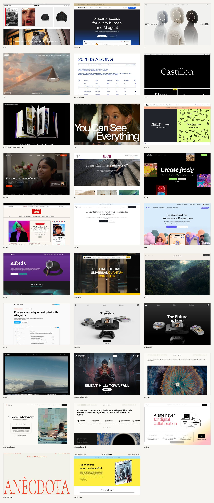

## How it works

When Claude builds or reviews an interface, the skill makes it:

1. **Inspect** the project's own design system first (DESIGN.md, tokens, Tailwind config, components). The project always wins over a reference.
2. **Reference** only for a concrete decision: `find_refs.py "pricing page with comparison table"` returns up to three screens, best first, with their screenshots and the tokens measured on the live page.
3. **Build** with the project's components, following the taste rules (one type family, a real scale, neutral surfaces and one accent, one radius family, real content only).
4. **Review** the rendered screen at 1440px and 390px against the anti-slop checklist, and fix what it finds.

When a project has no design system, or a messy one, the skill sets one up with `references/design-systems.md` (token layers, 12-step colour scales with defined roles, type roles, spacing, radius, elevation, motion, component states) and writes it down in `assets/DESIGN.md`, using the best public systems in the library (Vercel Geist, GitHub Primer, IBM Carbon, Material 3, Radix, shadcn/ui, Atlassian, GOV.UK, Apple HIG…) as references.

References are evidence, never templates: Claude takes the decision behind a screen (hierarchy, density, rhythm), not its logo, copy or layout.

## What a search returns

```
$ python3 scripts/find_refs.py "linear pricing" --limit 1
query: linear pricing

## 1. Linear · pricing
url: https://linear.app/pricing  ·  captured 2026-11-22
desktop: …/ui-taste/library/screens/linear-pricing-desktop.jpg  (1440x3600)
patterns: dark, pricing-4-tier, comparison-table, billing-toggle-per-plan
why: Four plans in plain columns with no card boxes: name, price, one line, a checklist. Only the Business button is filled. The billed-yearly toggle sits inside each paid column, right where the price changes.
fonts: Inter Variable
type: h1 Inter Variable 48px/1 w510 ls -1.056px · h2 Inter Variable 72px/1 w510 ls -1.584px · body Inter Variable 15px/1.6 w400 ls -0.165px
colours: bg #08090a · surfaces #08090a, #5e6ad2, #e5e5e6, #ffffff · text #d0d6e0, #8a8f98, #f7f8f8, #08090a
button: "Sign up" bg #e5e5e6 text #08090a radius 9999px height 32px padding-x 12px Inter Variable 13px w510
content max-width: 1436px
```

Claude then opens the screenshot with its Read tool and looks at it before deciding.

## The library

| Page type | Screens | Sites |
|---|---|---|
| landing | 568 | 032c, 1Password, 1X, 1×1, 2020 IS A SONG, 205TF, A Journal on How to Wow People, A24, Ableton, Abridge, Aeon, Affinity, Air Mail, Airtable, Alan, Alfred, Alice & Bob, Aman, Amie, Analogue, Analogue 3D, Anduril, Annapurna Interactive, Anthropic, Anthropic Claude, Anthropic Research, Anytype, Anècdota Rural, Apartamento, Apple, Arc, Arc Boosts, Arc Institute, Archer, Are.na, Are.na Blog, Area 17, Asana, Asket, Aspen Search, Astranis, Astro, Attio, Augment Code, Axiom, Barbican, Bartender, Base Power, Basecamp, Baseten, Beacon, Bear, Bee, beehiiv, Benjamin Righetti, Bezi, Blaze Type, Bleibtgleich, Bluesky, Boiler Room, Bolt, Boom Supersonic, Bou, Brex, Bridge, Browser Use, Browserbase, Buck, Buena Dev, Bun, Bunny, Bureau Borsche, Bureau Brut, Buttondown, Cabalar Meat Co., Cal.com, Capacities, Carrot Weather, Cartesia, Cash App, Cassette Music, CHCKN, Chronically Online Magazine, Clay, CleanShot, Clerk, Click Therapeutics, ClickHouse, Cline, Cloudflare, Coda, Cognition, Cohere, Collins, Collins Work, Collletttivo, Commercial Type, Commonwealth Fusion, Contra, Convex, Cooper Hewitt, Cosmos, Count, COVEO Music, Cowboy, Craft, CSS Tricks, Cursor, Date of Birth, Day.ai, Daylight, Dazed, Decagon, DecideAI, Deepgram, Delphi, Demande Spéciale, Denmu, Deno, Descript, Designboom, Devin, Dia, Die Carz, Dinamo, Discord, Displaay, DOC, Docker, Dovetail, Drafts, Drizzle, DRĄSA Studio, Dub, Duolingo, Dust, E2B, Early Studies, Effect, Elektron, ElevenLabs, Encore, Enode, Equals, Etched, Ethan Marcotte, Every, Excalidraw, Expo, Extropic, Eye on Design, Fabric, Factory, Fairphone, fal, Family, Fantasy, Fantasy Dreams, Fathom, Fictional, Figma, Figma Buzz, Figma Config, Figma Config Recap, Figma Sites, Figma Slides, Figure, Firecrawl, Flexport, Flighty, Fly by Jing, Fly.io, folk, Fonts In Use, Frame.io, Framer, Friend, Front, Function Health, Furniture Connect, Future Fonts, Galerie Russi Klenner, Garage, GASS Records, Gather, Gentler Streak, Ghost, Ghostty, Ginkgo Bioworks, GitHub, GitHub Universe, Gleb Kuznetsov, Glossier, Google DeepMind, Granola, Graphite, Greptile, Gretel, Grilli Type, Groq, GSAP, GT Standard Minisite, Gumroad, Gusta, Hadrian, Halide, Hard Sun, Harvey, Haus, Headspace, Hebbia, Hebbia Matrix, Hedra, Hemispherical Stacks, Heptabase, Hermeus, Heroicons, Hex, HEY, Hey Calendar, Hey Studio, HeyGen, Holographik Space, Hoverstat, How&How, Hugging Face, Hugging Face Spaces, Humaaans, Hume AI, Hungry Tiger, iA Writer, Ideogram, Increase, Infisical, Inngest, Instrument, Intercom, Intercom Fin, Ironclad AI, Isomorphic Labs, It's Nice That, Jam, Jason Santa Maria, Jaytel, Jen Simmons, JetBrains Mono, Jitter, Jonite, K2 Space, Kagi, Kevin Hipke, Kilo Code, Klim Type Foundry, Knock, Komoot, Koyeb, Kyiv Cannabis Club, Kyutai, Ladder, Langfuse, Layer, Ledger, Legora, Leica, Letta, Levels, Light Phone, Lightmatter, Lindy, Linear, Linear Mobile, Linear Readme, LinkLetter, Lithic, Liveblocks, Locomotive, Locomotive Work, Loewe, Logseq, Loom, Loops, LouieLouie, Luma, Luma AI, Lydia, Lynn Fisher, Maggie Appleton, Magic Patterns, Mailchimp, ManvsMachine, March 2004, Mastodon, Material-Archiv, Maze, Mercury, Mercury Personal, Mercury Raise, Microsoft AI, MICRtype, Minimal Gallery, Mintlify, Miro, Mistral AI, Mobbin, Modal, Modern Treasury, Moe Amaya, Monarch, Monocle, Monzo, Moog, MotherDuck, MSCHF, Mullvad, Muse, Mutebox, Mux, mymind, N26, n8n, NaN, Neon, Netlify, Neuralink, Neusicht, Niklas Rosén, NKORA, Normal Computing, Northflank, Nothing, Notion, Notion Sites, NTS, Oatly, Obsidian, OH no Type, Oklo, Old Tom Capital, Olipop, Ollama, Oma Appel, Omsom, On, Operate, Optimizely, Optimo, Order, Ordinary Folk, Oura, Overbrowsing, Paddle, Panda CSS, Pangram Pangram, Panic, Panic Software, Paper, ParadeDB, Parallel, Partiful, Pennylane, Penpot, Pentagram, Perplexity, Phantom, Phosphor Icons, Photoroom, Piccalilli, Pika, Pitch, Pitchfork, Pixelmator, Plaid, Plain, Planet, PlanetScale, Plausible, Playdate, Playdate Catalog, Polar, Polestar, Poolside, Porter, Porto Rocha, Portrait, PostHog, PostHog Max, PP Neue Montreal, Prisma, Procreate, Production Type, Proton, Provider Studio, Public, Pulitzer Art Foundation, Pylon, Qonto, Quanta, Quo, Rabbit, Railway, Rainbow, Ramp, Rapha, Rauno, Raycast, Readwise, Readwise Reader, Readymag, Recess, Recraft, Recursive, Reddit Inc, Reflect, Registered Commons, Rejouice, Relativity Space, Relume, Render, Replicate, Resend, Rest of World, Restate, Retool, Rive, Robin Sloan, Rogo, Rogue Amoeba, Rows, Runway, RUX Software, Sagmeister Walsh, Sana Labs, Sanity, Saronic, Savate Specimen, Savee, SavvyCal, Scale AI, Schema, Science Corp, Screen Studio, Scribd, Sentry, Sentry Seer, Sesame, SevenGrid, SFMOMA, Shield AI, Shopify, Side Stage Ventures, Sidebar, Sierra, Signal, Sketch, Slack, Slate Auto, Snackpass, Society, Sociotype, Soho House, Sorare, Soundtrap, SpaceX, Span, Spellbook, Spline, Spline AI, Spotify, Squarespace, Stable Audio, Stedelijk, Steel, Stoke Space, Storybook, Strava, Stripe, Stripe Atlas, Stripe Press, Stripe Sessions, Structured, Studio Freight, Stytch, Subframe, Sunday, Suno, Sunsama, Supabase, Supabase Launch Week, Supergiant Games, Superhuman, Superlist, Superpower, Svelte, Swile, Swiss Typefaces, Tailscale, Tana, TanStack, Tate, Tavus, Teenage Engineering, Teenage Engineering Field, Teenage Engineering OP-1, Telegram, Tella, Tempo, Temporal, Tenstorrent, Tequs, TeTuhi, The Browser, The Browser Company, The Content Architecture, The Pudding, The Verge, Things, Thinking Machines, Three.js, Tightype, Tinybird, tldraw, Tobias van Schneider, Toormix, Trigger.dev, Turborepo, Turso, Twenty, Typefully, Typewolf, Typotheque, Udio, Ulysses, Uncut, Unify, Union Boulangerie, Upstash, v0, Val Town, Van Gogh Museum, Vanta, Vapi, Varda, Vectary, Vercel, Vercel Conf, Vercel Ship, Village, Vitsoe, Walker Art Center, Warp, Webflow, Weekrise, Whimsical, Whitney Museum, Wieden+Kennedy, Wise, Wolff Olins, Wordware, Work & Co, WorkOS, Works in Progress, xmcp, Y Combinator, Zak Group, Zapier, Zed, Zep, Zipline |
| pricing | 28 | Attio, Cal.com, Clerk, Cursor, Dub, Figma, Framer, Ghost, Kagi, Linear, Loops, Mux, n8n, Netlify, Notion, Obsidian, PostHog, Railway, Raycast, Render, Resend, Sentry, Stripe, Tailscale, Vercel, Warp, Webflow, Zed |
| dashboard | 15 | Artificial Analysis, Fathom, GitHub, Mercury, OpenPanel, Plausible, shadcn/ui, Simple Analytics, Tailwind Catalyst, Tremor, ultrasound.money, Umami, Uniswap |
| app screen | 11 | Cal.com, FotMob, GitHub, Hugging Face, Hyperliquid, Our World in Data, Robinhood, Spotify, Y Combinator, Yr |
| status page | 8 | Anthropic, GitHub, Linear, OpenAI, OpenStatus, Resend, Stripe, Vercel |
| design system | 29 | Adobe Spectrum, Apple HIG, Atlassian Design System, Base UI, Duolingo Design, GitHub Primer, GitLab Pajamas, GOV.UK Design System, IBM Carbon, Material 3, Microsoft Fluent 2, Radix, React Aria, shadcn/ui, Shopify Polaris, Uber Base, Untitled UI, Vercel Geist, Wise Design |
| 404 page | 6 | GitHub, Oura, Polar, Raycast, Resend, Stripe |
| about | 5 | Linear, Notion, PostHog, Stripe |
| careers | 6 | Linear, Ramp, Raycast, Resend, Stripe, Vercel |
| contact | 4 | Attio, Linear, Stripe, Vercel |
| integrations | 6 | Attio, Cal.com, Linear, n8n, Raycast, Vercel |
| developers | 3 | Figma, Linear, Notion |
| brand | 3 | Linear, Resend, Vercel |
| auth | 5 | Cal.com, Figma, Linear, Notion, Vercel |
| product | 3 | Apple, Daylight, Teenage Engineering |
| changelog | 3 | Linear, Raycast, Resend |
| docs | 3 | Resend, Stripe, Tailwind CSS |
| customers | 2 | Linear, Vercel |
| blog | 2 | Linear, Vercel |

**710 pages from 603 sites and design systems, each captured on desktop and mobile (1420 screenshots).**

Every screen is captured at 1440px (desktop, first 3600px) and 390px (mobile), with cookie banners refused and chat widgets hidden. Tokens are read from the browser's computed styles: fonts, h1/h2/h3/body sizes, line heights and tracking, background, surface and text colours by area covered, button fill, radius, height and padding, and content width.

### Landing pages


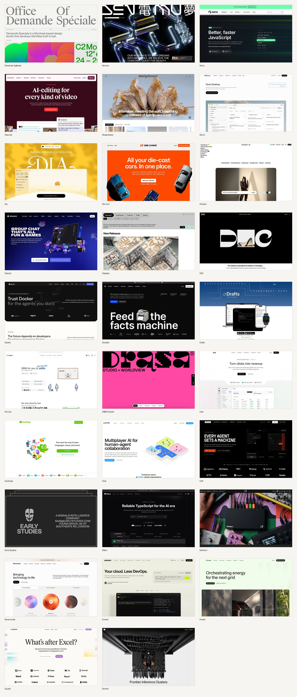


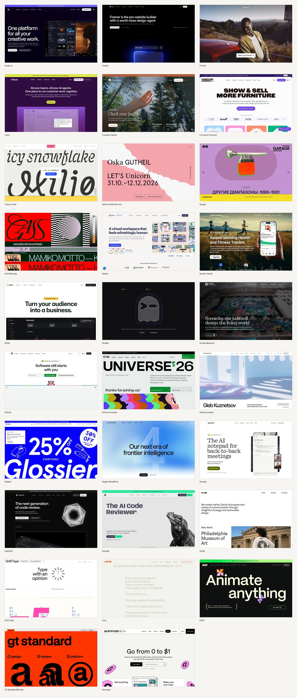

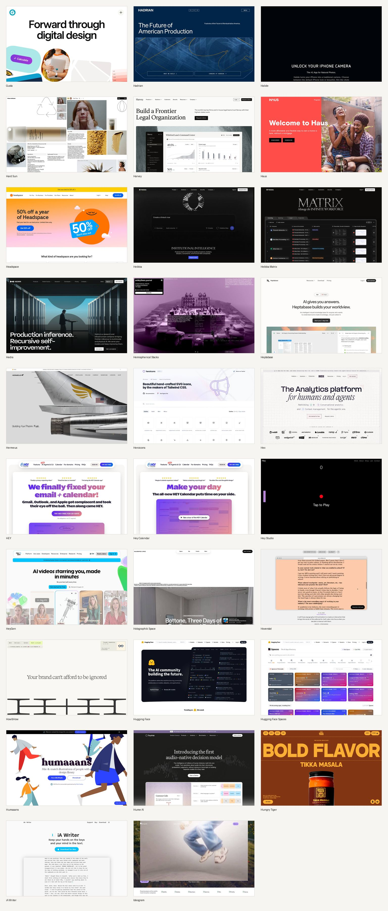


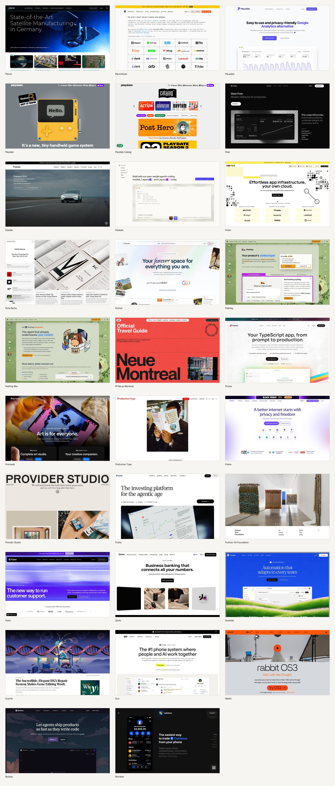

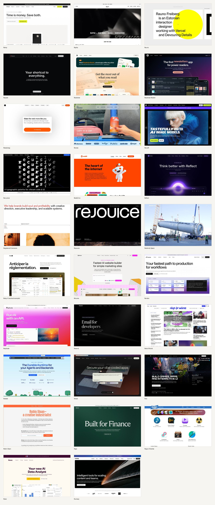

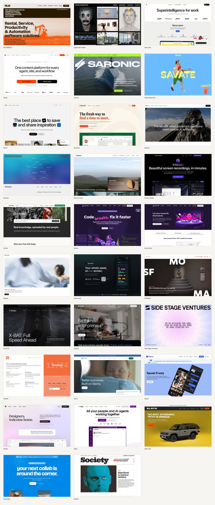


### Mobile


### Pricing


### Dashboard


### App screens

Product screens from other domains: banking, trading, weather, music, sport, scheduling, CI, roadmaps.

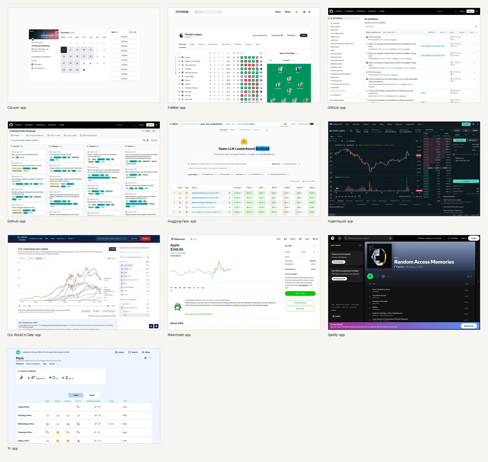

### Status page


### Design system


### 404 page


### About


### Careers

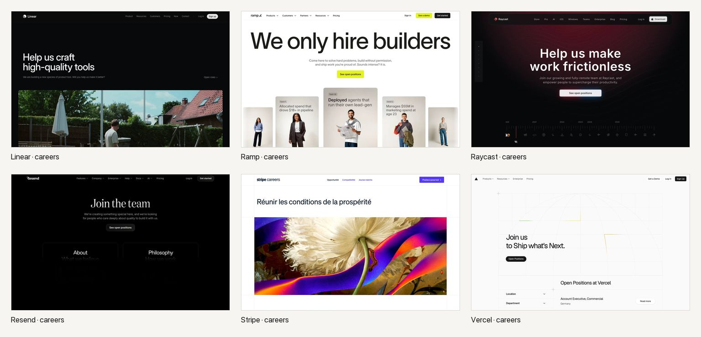

### Contact


### Integrations


### Developers


### Brand

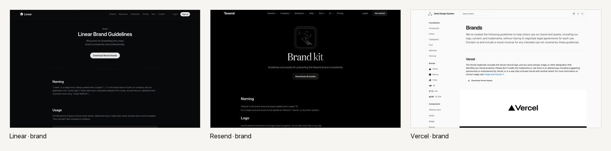

### Auth


### Product


### Changelog


### Docs


### Customers

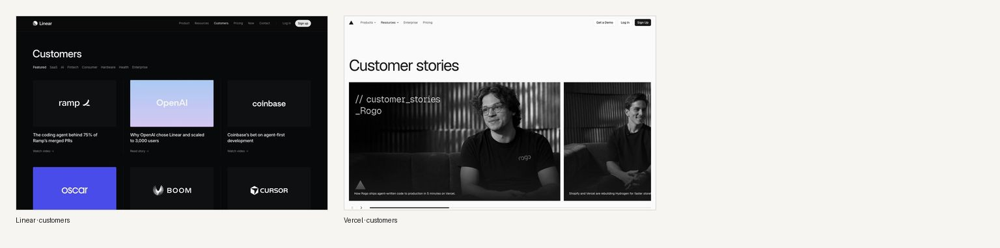

### Blog


## Landing pages

Ask for a landing page and the skill does not reach for a template. It finds the raw material first (what the product does that others do not, its own medium, the customer's world), proposes three concepts from three different directions (poster, colour field, the product as the hero, object and photography, editorial, illustrated world, brutalist, image sandwich…), recommends one and gives it a signature move that would look wrong on any other product's site. A swap test closes the review: with a competitor's logo on it, the page should stop working. The process is in `skills/ui-taste/references/landing-concepts.md`.

Photos, artworks and illustrations stay the client's: the skill never fakes them. It uses the images the brand already has, designs image slots with an art-direction brief for the rest (an empty slot shows its brief, not a fake), and once the client drops their files in, `scripts/slots.py` measures each one (ratio, brightness, text colour, palette) so the page is adapted to it: crop, text colour, veil, accent. When there is nothing yet, `scripts/find_art.py` borrows a public-domain painting, engraving or photograph from The Met or the Cleveland Museum of Art (CC0 only), with its credit line; `backdrop.py` can cut its foreground so it passes in front of the product. The fixed demo on the site stands on Van Gogh's *Wheat Field with Cypresses* that way. See `skills/ui-taste/references/imagery.md`.

The image sandwich is one of those directions, with its own recipe (`references/landing-recipe.md`), eight reference landings (`find_refs.py "image sandwich"`), a template (`assets/landing-hero/`) and `scripts/backdrop.py` to prepare the images.


## Browse the library

`site/` holds a landing page for the skill (`index.html`, a page that measures itself: press M) and the library (`library.html`). The library has collections (dark heroes, serif and editorial, illustrated worlds, pricing pages, design systems…), search, filter by page type and pattern, switch desktop and mobile, and open a screen to see why it is in the library, its fonts, type scale, colours (click to copy) and buttons rebuilt from the measured styles. Arrow keys move between screens, `/` focuses the search.

```bash
open site/index.html          # the landing; no server needed
open site/library.html        # the library
python3 site/build.py         # after adding screens: thumbnails and data
```


## Install

### Claude Code (plugin)

```
/plugin marketplace add rob1-alt/ui-taste
/plugin install ui-taste@ui-taste
```

Then ask: `Redesign our pricing page`, `This dashboard looks generic, fix it`, or call it with `/ui-taste:ui-taste`.

### Manual

```bash
git clone https://github.com/rob1-alt/ui-taste.git
cp -r ui-taste/skills/ui-taste ~/.claude/skills/ui-taste
```

Searching needs only Python 3. Capturing new screens needs:

```bash
pip install playwright pillow
python3 -m playwright install chromium
```

## Add your own screens

```bash
cd skills/ui-taste/scripts
python3 capture.py https://example.com/pricing --site Example --type pricing \
  --tags "pricing-3-tier,comparison-table" --note "What is worth learning from it"
python3 capture.py --batch sources.json           # refresh the whole library
python3 contact_sheet.py ../../../docs            # rebuild the sheets above
```

Add a screen only when it teaches a decision, and write the note as a lesson, not a description.

## Repository

```
.claude-plugin/            plugin and marketplace manifests
skills/ui-taste/
  SKILL.md                 the workflow Claude follows
  references/
    taste-rules.md         what the library's screens have in common
    anti-slop.md           the review checklist
    brief-template.md      a short brief before building a screen
    design-systems.md      how to set up or clean up a design system
    landing-concepts.md    distinctive landings: real assets, three concepts, signature move
    imagery.md             image slots, art direction, adapting to the client's images
  assets/
    DESIGN.md              the template to write a design system down
  scripts/
    find_refs.py           search the library
    capture.py             add or refresh screens (Playwright)
    contact_sheet.py       build the README sheets
    slots.py               list image slots, measure the client's images
    find_art.py            public-domain artworks (The Met, Cleveland), contact sheet, credit
    sources.json           the pages in the library
  library/
    index.json             screens, patterns, notes, measured tokens
    screens/               desktop and mobile captures
site/                      landing (index.html), library (library.html), build.py, thumbs/
docs/                      contact sheets for this README
```

## Rights

The screenshots belong to the companies that made those pages. They are kept here as private design references for study, the way a designer keeps a moodboard, and are not to be republished. Keep this repository private.
